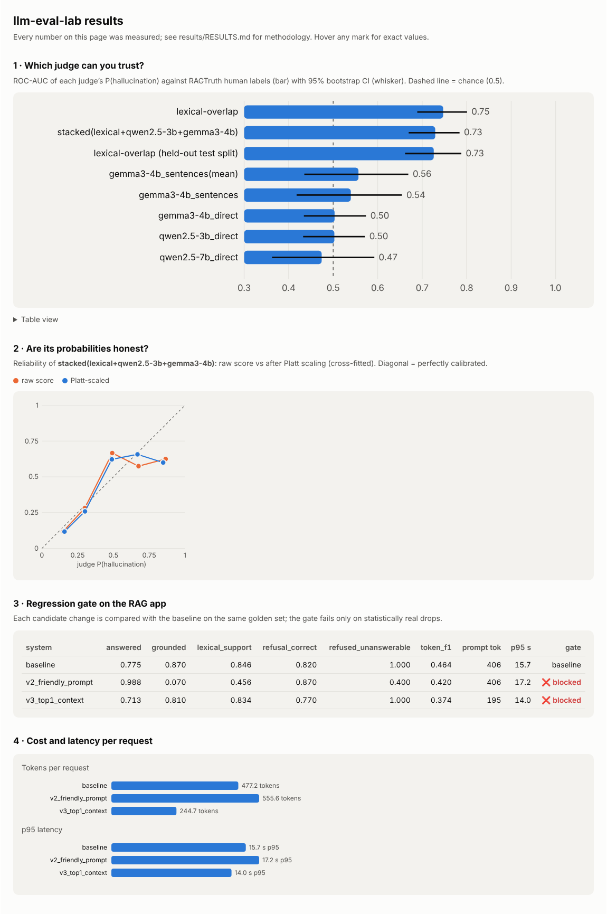

# LLM Eval Lab

[](https://github.com/juhidixit/llm-eval-lab-/actions/workflows/ci.yml)


An evaluation toolkit for LLM applications, built around one question every team shipping
LLM features has to answer: **can this change go to production?**

It covers the parts an eval stack needs to be trusted in CI:

* **Golden datasets.** Versioned, content-hashed JSONL with slices (e.g. *unanswerable*) and optional human labels.
* **LLM-as-judge, calibrated against humans.** Judges return a *probability* (from first-token
  log-probs), so they get ROC-AUC, tuned thresholds, Cohen's κ with CIs and Platt scaling, all
  measured against human labels before a judge is allowed to gate anything.
* **RAG metrics.** Faithfulness (direct, chain-of-thought, and RAGAS-style claim decomposition),
  context precision and recall, answer relevance, plus deterministic metrics (EM, token-F1,
  refusal detection, JSON validity).
* **Cost and latency on every call.** Token counts and wall-clock latency are recorded per call,
  with p50/p95 and projected $ per 1k requests at list prices.
* **A statistical regression gate in CI.** It runs on a paired bootstrap plus an exact McNemar
  test, so a build fails on *real* drops and doesn't flake on noise. LLM calls are recorded once
  into **cassettes** and replayed in CI, so the gate is deterministic, free and needs no GPU or API key.
* **A dashboard.** A static HTML page you can open without a server.

Everything runs on a laptop CPU with open-weight models (Qwen 2.5 and Gemma 3 via llama.cpp). The same code talks to any OpenAI-compatible endpoint (vLLM, Ollama, OpenAI) or to Claude.

> **Every number below was measured** by running real models, and CI recomputes it from the
> committed cassettes. Nothing is simulated. The headline result is a negative one: the small
> open-weight judges were no better than chance against human labels, and the lab caught that
> *before* they were used to gate anything.

---

## Architecture

```mermaid
flowchart LR
    subgraph Data
      G[(Golden set<br/>JSONL · sha256 version)]
      H[(Human labels<br/>RAGTruth)]
    end
    subgraph Run["evallab run (suite.yaml)"]
      S[System under test<br/>prompt · context budget · model] --> O[Outputs]
      O --> D[Deterministic metrics<br/>refusal · token-F1 · EM · JSON]
      O --> J[LLM judge<br/>P&#40;hallucination&#41; from log-probs]
      O --> R[RAG metrics<br/>context precision / recall]
    end
    G --> S
    P[[Providers<br/>llama.cpp · OpenAI-compatible · Anthropic]] --- C[(Cassettes<br/>record / replay)]
    C --- S & J & R
    H --> CAL[Judge calibration<br/>AUC · κ · ECE · Platt · threshold]
    CAL -- "picks judge + threshold" --> J
    D & J & R --> RUN[(Run record<br/>per-example scores · CIs<br/>tokens · p50/p95 · $)]
    RUN --> GATE{Regression gate<br/>paired bootstrap · McNemar}
    B[(Baseline run)] --> GATE
    GATE -- pass/fail + markdown --> CI[GitHub Actions<br/>job summary]
    RUN --> DASH[HTML dashboard]
```



| Component | What it does | Code |
|---|---|---|
| Datasets | Golden-set schema, content-hash versioning, slices, RAGTruth loader | [`datasets/`](src/evallab/datasets) |
| Providers | One `Request → Completion` interface with tokens and latency on every call. Backends: in-process llama.cpp (exact first-token log-probs), any OpenAI-compatible server, Anthropic | [`providers/`](src/evallab/providers) |
| Cassettes | Record/replay cache keyed on the full request. `replay` mode never touches the network | [`providers/cache.py`](src/evallab/providers/cache.py) |
| Judges | Faithfulness judges: `direct` (1 call, ~1 output token), `cot`, `claims` (extract and verify) | [`judges/faithfulness.py`](src/evallab/judges/faithfulness.py) |
| Calibration | Precision/recall/F1, Cohen's κ, ROC-AUC (tie-aware), ECE, reliability bins, Brier, Platt scaling, cross-fitted thresholds, bootstrap CIs | [`calibration.py`](src/evallab/calibration.py) |
| RAG metrics | Context precision@k (AP), context recall, answer relevance (implemented and unit-tested; not yet part of the measured experiments) | [`metrics/rag.py`](src/evallab/metrics/rag.py) |
| Runner | Suite YAML → per-example outputs and scores, CIs, ops stats | [`runner.py`](src/evallab/runner.py) |
| Gate | Floors, max-drop rules that need statistical significance, latency/cost budgets, dataset-version guard | [`gate.py`](src/evallab/gate.py) |
| Dashboard | Static HTML (inline SVG, light/dark, table views) | [`report.py`](src/evallab/report.py) |

### Design decisions

* **A judge is a model too, so it gets evaluated first.** No judge gates a build until its
  agreement with human labels is measured. That includes a non-LLM baseline it has to beat.
* **Scores, not just verdicts.** Reading P("Yes") from the first-token log-probs costs one output
  token and turns a judge into a classifier you can threshold and calibrate. If a backend has no
  log-probs (e.g. the Anthropic API), the judge falls back to the parsed verdict.
* **Gate on significance, not on deltas.** A 1-point drop on 150 examples is usually noise. The
  gate fails only when the drop is larger than the allowed budget *and* the paired bootstrap says
  it is real (one-sided p < 0.05). It reports how many items regressed and how many got fixed.
* **The golden set is versioned.** Runs record the dataset hash, and the gate refuses to compare
  runs made on different versions. That way an edited golden set can't pass for a model improvement.
* **Record once, replay in CI.** Changing a prompt changes the cache key, so CI fails with a
  cache miss until someone records the new behaviour with `make gate-record`. Unevaluated prompt
  changes can't slip through.
* **The judge is never calibrated on the questions it gates.** Calibration uses RAGTruth's
  *train* split. The golden set comes from its *test* split.

---

## Results

All numbers come from real model outputs on a 4-vCPU cloud VM (no GPU), with Q4_K_M GGUF
models in llama.cpp. They are reproducible from the committed cassettes in seconds
(`make gate`, plus the two calibration commands under *Reproduce*), and CI recomputes them on
every push. Intervals are 95% bootstrap CIs.



### Experiment 1: can small open-weight LLM judges detect hallucinations?

**Setup.** 300 RAG answers from RAGTruth's QA *train* split (120 with at least one
human-annotated hallucinated span, 180 without; at most one answer per source per class).
The answers come from GPT-4, GPT-3.5, Llama-2 7/13/70B and Mistral-7B. Each judge outputs
P(hallucinated), which is scored against the human label. Tuned thresholds and Platt scaling
are **cross-fitted** (fit on one half, scored on the other) so they aren't optimistic.
Full table: [`judge_calibration/summary.md`](results/judge_calibration/summary.md).

| judge | n | ROC-AUC [95% CI] | κ at tuned threshold | cost per judgement |
|---|---:|---:|---:|---:|
| **lexical overlap** (non-LLM baseline) | 300 | **0.75** [0.69, 0.80] | **0.37** | ~0 ms |
| lexical overlap, **held-out test split** | 244 | 0.73 [0.66, 0.79] | 0.25 | ~0 ms |
| stacked: lexical + Qwen2.5-3B + Gemma-3-4B (cross-fitted LR) | 300 | 0.73 [0.67, 0.78] | 0.32 | 3 calls |
| Gemma-3-4B, sentence-level (mean over sentences) | 101 | 0.56 [0.44, 0.67] | -0.03 | ~4.2k prompt tokens |
| Gemma-3-4B, direct | 300 | 0.50 [0.43, 0.57] | -0.03 | ~590 prompt tokens, 1 output token |
| Qwen2.5-3B, direct | 300 | 0.50 [0.43, 0.57] | 0.01 | ~590 prompt tokens, 1 output token |
| Qwen2.5-7B, direct | 103 | 0.47 [0.36, 0.59] | 0.05 | ~580 prompt tokens, 1 output token |

On the same first 101–103 examples, lexical overlap scores ROC-AUC 0.79.

**Findings**

1. **The 3–7B local judges are at chance on this task.** Each CI contains 0.5. Scaling from 3B
   to 7B did not help on the 103-example subset.
2. **Each judge is biased in a different direction, so verdicts can't be trusted as-is.** At the
   0.5 threshold Gemma-3-4B flags 99% of answers, Qwen2.5-3B 69% and Qwen2.5-7B 11% (true rate:
   40%). Platt scaling fixes Qwen2.5-3B's probabilities (ECE 0.30 → 0.08), but it cannot add
   ranking ability that isn't there.
3. **Why they fail:** most RAGTruth QA hallucinations are one unsupported sentence inside a long,
   otherwise faithful answer (e.g. an added safety tip, or a "$200" that becomes "$200 per square
   foot"). Holistic yes/no judging misses them. Checking sentence by sentence (KV-cache reuse
   keeps it cheap) moved Gemma-3-4B from 0.50 to 0.56, which is still far from usable.
4. **A free lexical heuristic beats every LLM judge here,** and adding the judges to it doesn't
   help (0.73 stacked vs 0.75 alone). The heuristic's one design choice was to treat short pure
   refusals as supported, and it was made while looking at this sample. On RAGTruth's held-out
   **test** split it still scores 0.73.
5. **Consequence for the gate:** experiment 2 gates on the calibrated lexical `grounded` metric
   (minimum support 0.70, between the two cross-fitted F1-optimal thresholds of 0.68 and 0.75), *not* on an LLM judge. That is the whole
   point of calibrating first: without this step, CI would have been gated on a coin flip.

**Not measured here:** judges larger than 7B or API models (Claude, GPT-4-class). The
`anthropic` and `openai_compat` providers are implemented. Running
`experiments/judge_calibration.py` with them is the obvious next step. The RAGTruth paper
reports prompted GPT-4-class detectors well above chance on this task.

### Experiment 2: does the CI gate catch realistic regressions?

**System under test.** A RAG QA app (Qwen2.5-3B, greedy decoding, max 150 output tokens) using
RAGTruth's original QA prompt. **Golden set:** 100 questions from RAGTruth's *test* split (MS MARCO):
80 answerable, with human-verified reference answers, plus 20 **unanswerable** ones whose
passages were swapped with another question's. **Candidates:** two changes that look harmless
in a code review:

* **v2 "friendlier prompt":** "give a complete and helpful answer … add useful background from
  your own knowledge".
* **v3 "send only the top-1 passage":** cuts prompt tokens to save cost and latency.

| metric | baseline | v2 friendly prompt | v3 top-1 context |
|---|---:|---:|---:|
| grounded (lexical support ≥ 0.70) | 0.87 | **0.07** ❌ | 0.81 |
| refused when unanswerable (20) | 1.00 | **0.40** ❌ | 1.00 |
| answered when answerable (80) | 0.78 | 0.99 | 0.71 |
| refusal correct (all 100) | 0.82 | 0.87 | **0.77** ❌ (floor 0.80) |
| token-F1 vs reference | 0.46 | 0.42 | **0.37** ❌ |
| prompt / output tokens per request | 406 / 72 | 406 / 150 | **195** / 50 |
| latency p50 / p95 (s, CPU) | 8.8 / 15.7 | 15.2 / 17.2 | **4.4** / 14.0 |
| projected $ per 1k requests at Claude Haiku 4.5 list price | 0.76 | 1.16 | **0.44** |
| **gate** | – | **blocked** | **blocked** |

Gate reports: [`gates/v2_friendly_prompt.md`](results/gates/v2_friendly_prompt.md),
[`gates/v3_top1_context.md`](results/gates/v3_top1_context.md).

**Findings**

1. **v2 shows why slice-level gates matter.** Overall "refusal correct" *improved*
   (0.82 → 0.87), because the friendlier prompt stopped over-refusing answerable questions. But on
   the unanswerable slice, the share of questions it correctly refused fell from 20/20 to 8/20
   (12 regressions, 0 fixes, p < 0.001). An aggregate-only dashboard would have shipped this.
2. **v3 is a real trade-off, and the gate makes it visible.** Prompt tokens drop 52% and
   projected cost 42%, but answer overlap with the reference falls 0.46 → 0.37 (paired bootstrap
   p = 0.001). The grounded drop (−0.06, p = 0.11) is *not* treated as a regression, because it
   isn't statistically distinguishable from noise on 100 questions.
3. **Replay makes this CI-friendly.** Recording took about 1.5 h of CPU. Replaying all three
   runs and both gate decisions takes about 2 s, with no model, GPU or API key.

Caveats: latencies were measured on a shared 4-vCPU VM while other jobs were sometimes
running, so treat them as relative. v2 always hits the 150-token cap, which also lowers its
token-F1.


---

## Reproduce

```bash
git clone https://github.com/juhidixit/llm-eval-lab- && cd llm-eval-lab-
pip install -e ".[dev]"
make test                 # unit + end-to-end tests (no models needed)
make gate                 # replay experiment 2 from cassettes: same numbers, in seconds
python experiments/judge_calibration.py --cache replay --judges $(cat results/judge_calibration/JUDGES)
python experiments/analyze_calibration.py   # replay experiment 1 from cassettes
make dashboard            # results/dashboard.html
```

Re-running with live models (CPU is fine, it just takes a few hours):

```bash
pip install -e ".[local]"   # llama-cpp-python
make models                 # ~9 GB of GGUF weights
make calibrate              # experiment 1
make gate-record            # experiment 2
```

Using it on your own app means writing a suite. Point `dataset` at your golden JSONL, set the
system config and judge, and choose gate rules:

```yaml
gates:
  faithfulness:    {min: 0.80, max_drop: 0.03}   # floor + significant-drop budget
  refusal_correct: {min: 0.80, max_drop: 0.03}
  latency_p95_s:   {max_increase_pct: 50}
```

Any OpenAI-compatible server works as a provider (`kind: openai_compat`, `EVALLAB_BASE_URL=...`),
and so does Claude (`kind: anthropic`, `pip install -e ".[anthropic]"`).

## Project layout

```
src/evallab/         library + CLI (evallab run | gate | dataset | report)
suites/rag_qa.yaml   example suite: RAG QA app, judge, metrics, gate rules
prompts/             system-under-test prompt versions
data/golden/         golden sets (versioned JSONL)
cassettes/           recorded LLM calls (replayed in CI)
experiments/         experiment 1 (judge calibration) and 2 (regression gate)
results/             run records, gate reports, calibration tables, dashboard.html
tests/               unit + end-to-end tests
```

## Data and licences

* **RAGTruth** (Niu et al., ACL 2024), MIT, from [ParticleMedia/RAGTruth](https://github.com/ParticleMedia/RAGTruth).
  Its QA contexts come from MS MARCO, which is licensed for non-commercial research use. The
  derived golden set in `data/golden/` keeps that restriction.
* Models: Qwen 2.5 (Qwen licence) and Gemma 3 (Gemma terms). They are pulled at run time and not redistributed here.

MIT licence for the code.
