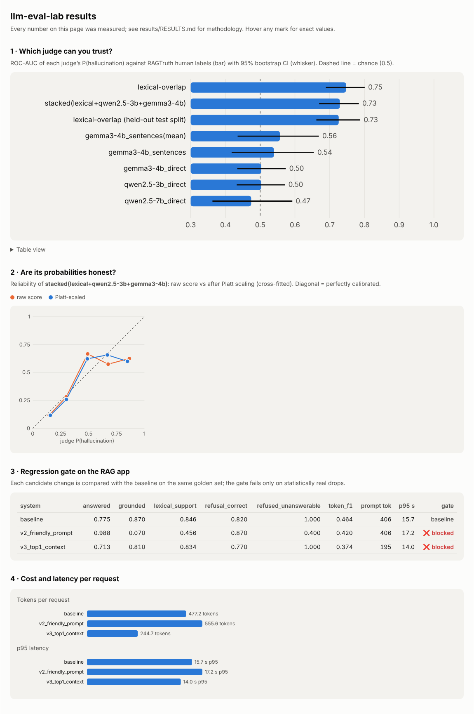

## Results

All numbers come from real model outputs on a 4-vCPU cloud VM (no GPU), with Q4_K_M GGUF
models in llama.cpp. They are reproducible from the committed cassettes in seconds
(`make gate`, plus the two calibration commands under *Reproduce*), and CI recomputes them on
every push. Intervals are 95% bootstrap CIs.

### Experiment 1: can small open-weight LLM judges detect hallucinations?

**Setup.** 300 RAG answers from RAGTruth's QA *train* split (120 with at least one
human-annotated hallucinated span, 180 without; at most one answer per source per class).
The answers come from GPT-4, GPT-3.5, Llama-2 7/13/70B and Mistral-7B. Each judge outputs
P(hallucinated), which is scored against the human label. Tuned thresholds and Platt scaling
are **cross-fitted** (fit on one half, scored on the other) so they aren't optimistic.
Full table: [`judge_calibration/summary.md`](judge_calibration/summary.md).

| judge | n | ROC-AUC [95% CI] | κ at tuned threshold | cost per judgement |
|---|---:|---:|---:|---:|
| **lexical overlap** (non-LLM baseline) | 300 | **0.75** [0.69, 0.80] | **0.37** | ~0 ms |
| lexical overlap, **held-out test split** | 244 | 0.73 [0.66, 0.79] | 0.25 | ~0 ms |
| stacked: lexical + Qwen2.5-3B + Gemma-3-4B (cross-fitted LR) | 300 | 0.73 [0.67, 0.78] | 0.32 | 3 calls |
| Gemma-3-4B, sentence-level (mean over sentences) | 101 | 0.56 [0.44, 0.67] | -0.03 | ~4.2k prompt tokens |
| Gemma-3-4B, direct | 300 | 0.50 [0.43, 0.57] | -0.03 | ~590 prompt tokens, 1 output token |
| Qwen2.5-3B, direct | 300 | 0.50 [0.43, 0.57] | 0.01 | ~590 prompt tokens, 1 output token |
| Qwen2.5-7B, direct | 103 | 0.47 [0.36, 0.59] | 0.05 | ~580 prompt tokens, 1 output token |

On the same first 101–103 examples, lexical overlap scores ROC-AUC 0.79.

**Findings**

1. **The 3–7B local judges are at chance on this task.** Each CI contains 0.5. Scaling from 3B
   to 7B did not help on the 103-example subset.
2. **Each judge is biased in a different direction, so verdicts can't be trusted as-is.** At the
   0.5 threshold Gemma-3-4B flags 99% of answers, Qwen2.5-3B 69% and Qwen2.5-7B 11% (true rate:
   40%). Platt scaling fixes Qwen2.5-3B's probabilities (ECE 0.30 → 0.08), but it cannot add
   ranking ability that isn't there.
3. **Why they fail:** most RAGTruth QA hallucinations are one unsupported sentence inside a long,
   otherwise faithful answer (e.g. an added safety tip, or a "$200" that becomes "$200 per square
   foot"). Holistic yes/no judging misses them. Checking sentence by sentence (KV-cache reuse
   keeps it cheap) moved Gemma-3-4B from 0.50 to 0.56, which is still far from usable.
4. **A free lexical heuristic beats every LLM judge here,** and adding the judges to it doesn't
   help (0.73 stacked vs 0.75 alone). The heuristic's one design choice was to treat short pure
   refusals as supported, and it was made while looking at this sample. On RAGTruth's held-out
   **test** split it still scores 0.73.
5. **Consequence for the gate:** experiment 2 gates on the calibrated lexical `grounded` metric
   (minimum support 0.70, between the two cross-fitted F1-optimal thresholds of 0.68 and 0.75), *not* on an LLM judge. That is the whole
   point of calibrating first: without this step, CI would have been gated on a coin flip.

**Not measured here:** judges larger than 7B or API models (Claude, GPT-4-class). The
`anthropic` and `openai_compat` providers are implemented. Running
`experiments/judge_calibration.py` with them is the obvious next step. The RAGTruth paper
reports prompted GPT-4-class detectors well above chance on this task.

### Experiment 2: does the CI gate catch realistic regressions?

**System under test.** A RAG QA app (Qwen2.5-3B, greedy decoding, max 150 output tokens) using
RAGTruth's original QA prompt. **Golden set:** 100 questions from RAGTruth's *test* split (MS MARCO):
80 answerable, with human-verified reference answers, plus 20 **unanswerable** ones whose
passages were swapped with another question's. **Candidates:** two changes that look harmless
in a code review:

* **v2 "friendlier prompt":** "give a complete and helpful answer … add useful background from
  your own knowledge".
* **v3 "send only the top-1 passage":** cuts prompt tokens to save cost and latency.

| metric | baseline | v2 friendly prompt | v3 top-1 context |
|---|---:|---:|---:|
| grounded (lexical support ≥ 0.70) | 0.87 | **0.07** ❌ | 0.81 |
| refused when unanswerable (20) | 1.00 | **0.40** ❌ | 1.00 |
| answered when answerable (80) | 0.78 | 0.99 | 0.71 |
| refusal correct (all 100) | 0.82 | 0.87 | **0.77** ❌ (floor 0.80) |
| token-F1 vs reference | 0.46 | 0.42 | **0.37** ❌ |
| prompt / output tokens per request | 406 / 72 | 406 / 150 | **195** / 50 |
| latency p50 / p95 (s, CPU) | 8.8 / 15.7 | 15.2 / 17.2 | **4.4** / 14.0 |
| projected $ per 1k requests at Claude Haiku 4.5 list price | 0.76 | 1.16 | **0.44** |
| **gate** | – | **blocked** | **blocked** |

Gate reports: [`gates/v2_friendly_prompt.md`](gates/v2_friendly_prompt.md),
[`gates/v3_top1_context.md`](gates/v3_top1_context.md).

**Findings**

1. **v2 shows why slice-level gates matter.** Overall "refusal correct" *improved*
   (0.82 → 0.87), because the friendlier prompt stopped over-refusing answerable questions. But on
   the unanswerable slice, the share of questions it correctly refused fell from 20/20 to 8/20
   (12 regressions, 0 fixes, p < 0.001). An aggregate-only dashboard would have shipped this.
2. **v3 is a real trade-off, and the gate makes it visible.** Prompt tokens drop 52% and
   projected cost 42%, but answer overlap with the reference falls 0.46 → 0.37 (paired bootstrap
   p = 0.001). The grounded drop (−0.06, p = 0.11) is *not* treated as a regression, because it
   isn't statistically distinguishable from noise on 100 questions.
3. **Replay makes this CI-friendly.** Recording took about 1.5 h of CPU. Replaying all three
   runs and both gate decisions takes about 2 s, with no model, GPU or API key.

Caveats: latencies were measured on a shared 4-vCPU VM while other jobs were sometimes
running, so treat them as relative. v2 always hits the 150-token cap, which also lowers its
token-F1.
